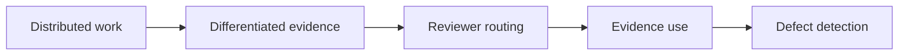

# TraceRoute Research

**Testing work-aware reviewer routing in LLM agent systems.**

Eugene Golovanov  
With Apart Research

Research conducted at the Swarm Alignment Hackathon, November 2026.

[Read the report (PDF)](docs/traceroute_report.pdf) · [Operational protocol](docs/traceroute_routing_pom.md) · [Experiment log](docs/sequential_pilot_launch.md)

> **Status: completed development study; no positive proof of mechanism established.** The five-task run completed all 120 reviews, but the intended differentiated-evidence prerequisite failed. Incomplete adjudication also prevented the full primary detection and false-positive comparison. This is not evidence of a measured null routing effect.

## Research question

Can the organization of distributed work help agents find and use better grounds for checking another agent's next step?

Different working branches may discover different results, constraints, counterexamples, and observations. TraceRoute tests whether choosing reviewers according to what they actually worked on improves verification relative to selecting reviewers randomly from the same pool.

The proposed mechanism is:



This is **not a swarm-versus-solver benchmark**. It does not test whether knowledge must remain with its original owner, and it does not establish an advantage beyond actual token consumption: budget caps are matched, but realized input lengths differ. Detecting a defect and preventing an erroneous action are separate endpoints.

## Experimental design

The completed study used five development-consumed SCI-AGENT-EXAM episodes: bioinformatics error diagnosis, chemistry result interpretation, materials-science literature synthesis, mathematics code generation, and physics-simulation tool orchestration.

Each episode assigned eight real working branches. Branches executed once; their observed histories and evidence were frozen and reused across routing conditions. The router received work profiles and proposal requirements, not hidden defect labels. All five episodes used the `unmet_precondition` defect family.

| Condition | Reviewer selection | Context |
| --- | --- | --- |
| `RandomHistory` | Two eligible workers sampled without replacement | Selected workers' frozen histories and shared review context |
| `WorkProfileOverlapRouted` | Profile-tag overlap, then complementary overlap, with frozen tie-breaking and fallback | Selected workers' frozen histories and shared review context |
| `Fresh` | Diagnostic reviewers without worker histories | Shared review context only |

The stored implementation name for `WorkProfileOverlapRouted` is `RoutedHistory`.

Valid and defective proposal variants, three conditions, two repeats, and two reviewers per panel produced 60 panels and 120 review slots. The main routing comparison held the worker pool, reviewer model, panel size, review instructions, budget caps, access rules, and completion criteria fixed. The task—not an individual review—was the paired analysis unit.

### Models used in the reported run

- Workers, author, and reviewers: `openai-codex/gpt-6.1-terra`.
- Card validation and primary evaluation: `openai-codex/gpt-6-astra`, in fresh contexts.
- Cross-model calibration and adjudication: `openai-codex/gpt-6.1-sol`.

These are the exact recorded subscription selectors. Earlier harness configurations describe other model assignments and should not be mistaken for this run's configuration. Agreement between model judges is not independent human validation.

### Evidence and measurement

Reviewers cite short references such as `[[ev:1]]`. The host resolves them to immutable evidence and provenance within the reviewer's permitted scope. A broken or inaccessible reference is a technical failure, not a scientific verdict.

Measurement separates evidence coverage, target citations, supported evidence use, correct defect detection, false positives, missingness, and costs. A valid reference proves source binding—not the truth or relevance of the cited material. Uncertain judgments remain uncertain; missing measurements are not converted into zeros.

## Findings

| Measure | Observed result |
| --- | --- |
| Worker assignments completed | 33 of 40 |
| Reviews completed with accepted evidence-reference contracts | 120 of 120 |
| Episodes with private-informed workers | 0 of 5 |
| Reviews with final scoring | 111 of 120 |
| Mandatory adjudications remaining uncertain | 9 |
| Complete five-task primary paired detection comparison | Unavailable |
| Primary false-positive rates | Unavailable under the frozen completeness rule |
| Preregistered private-evidence intervention | No eligible case; not executed |
| Downstream action-gate experiment | Not entered |

All designated target evidence was judged visible in the public card context. Registered evidence ownership differed, but reviewers did not need the original workers' histories to access the target grounds. Fresh reviewers reached the observed panel-detection ceiling.

Only chemistry and mathematics had complete paired detection measurements across both history conditions and repeats. Their paired differences were zero, but this selected two-task diagnostic does **not** establish equivalence or replace the missing five-task comparison.

**Interpretation:** the review-reference interface worked under this setup, but the study did not isolate the intended differentiated-evidence mechanism. It establishes neither a routing advantage nor its general absence. Earlier solver-grading results are separate diagnostics, not a routing baseline.

### Actual resource use

| Review condition | Calls | Input tokens | Output tokens | Summed call latency (seconds) |
| --- | ---: | ---: | ---: | ---: |
| Fresh | 40 | 132,867 | 7,729 | 265.67 |
| RandomHistory | 40 | 547,957 | 8,144 | 240.82 |
| WorkProfileOverlapRouted | 40 | 511,645 | 8,047 | 250.67 |

Across preparation, reviews, and measurement, the new run used 534 calls, 3,473,400 input tokens, and 150,935 output tokens. Summed provider latency was 6,847.01 seconds; it is not wall-clock time. Five earlier shared calibration calls are counted separately. Full methodology, denominators, and limitations are in the [report](docs/traceroute_report.pdf).

## Repository guide

| Path | Contents |
| --- | --- |
| `src/little_pom/` | Python harness: workers, evidence, cards, routing, reviews, measurement, runtime, and sandbox boundaries |
| `tests/` | Contract and behavioral tests |
| `config/little/` | Harness configurations; not all configurations describe the final five-task run |
| `docs/traceroute_report.pdf` | Research report, references, and appendices |
| `docs/traceroute_routing_pom.md` | Operational study protocol and transition criteria |
| `docs/sequential_pilot_launch.md` | Development history, execution amendments, and observed results |
| `docs/little_harness.md` | Harness installation, commands, contracts, and lifecycle |
| `little_experiment/` | Earlier design documents and implementation runbooks |
| `data/` | Benchmark acquisition notes and snapshot manifests |
| `environments/harbor/` | Harbor environment notes and dependency lock |

Some detailed research documents are in Russian. The report and this overview are in English.

## Local setup and software checks

Requirements: **Python 3.12** and [uv](https://docs.astral.sh/uv/).

From the repository root:

```bash
uv sync --locked --group dev
uv run --locked little-pom --help
uv run --locked python -m pytest -q -p no:cacheprovider
```

The publication check passed **642 tests**. This is a software verification result, not evidence for the scientific hypothesis.

For the harness's offline synthetic lifecycle, see [installation and offline execution](docs/little_harness.md#installation-and-offline-execution). The default mock lifecycle is an earlier three-task feasibility configuration, **not** a reproduction of the five-task scientific study. Synthetic model responses cannot establish a routing effect.

Live experiments additionally require explicitly configured model access, benchmark snapshots, Docker runtimes, and the corresponding readiness checks. Install `--extra live` only when using the optional Adaption integration; it does not supply model credentials or reproduce the subscription-based study. Do not insert credentials into prompts, source files, logs, or committed artifacts.

## Reproducibility boundary

This public repository contains the harness, tests, protocols, snapshot metadata, and final PDF. It is **not a complete raw-data replication package**.

The following remain local and are excluded from Git:

- `runs/`: raw experiment outputs, frozen pools, execution manifests, and run-specific launchers.
- `papers/`: downloaded literature and digitized copies.
- LaTeX sources and auxiliary report-build files under `docs/`.
- Downloaded upstream benchmark trees under `data/*/upstream/`.
- `temp/`, credentials, virtual environments, and caches.

Paths to these materials in the report identify local audit artifacts; a fresh clone does not contain them. Exact replay or independent reanalysis requires the corresponding frozen artifacts and inputs. The benchmark acquisition notes are in [SCI-AGENT-EXAM](data/sci-agent-exam/README.md) and [Terminal-Bench-Science](data/terminal-bench-science/README.md).

Unused `ground_truth/` drafts were removed from the current tree, but remain in earlier Git history. That history was not rewritten.

## Next experiment

The next step is another small routing proof of mechanism—not a larger swarm-versus-solver benchmark:

1. Validate evidence transport and end-to-end evaluation, including unresolved adjudication and false-positive reporting rules.
2. Fix episode selection and eligibility criteria before observing review outcomes. Record exclusions rather than replacing cases until routing wins.
3. Execute real branches once and freeze the common worker pool.
4. Before experimental reviews, verify that target grounds are differentiated, not already supplied by the public proposal, and addressable through the frozen work profiles.
5. Compare matched `RandomHistory` and `WorkProfileOverlapRouted` conditions, retaining `Fresh` as a diagnostic and reporting actual costs.
6. Measure the full chain from evidence delivery to supported use and detection, alongside false positives and missingness. Where eligible, use a preregistered development intervention to test whether removing evidence changes a justified judgment.

A later confirmatory set must exclude the development-consumed episodes. Only after a positive PoM should the study add an executable next action: reviewers recommend, while a separate control mechanism authorizes, delays, or rejects an action bound to a specific artifact version. That stage must measure erroneous actions performed, errors prevented, correct actions blocked, useful completion, and costs—not merely whether criticism was produced.

## Limitations and dual-use considerations

- Five development-consumed episodes and one defect family do not support broad generalization.
- Model evaluators can share errors; cross-model agreement is not a human expert oracle.
- Matched budget caps do not equal matched realized token use, and this study does not isolate a benefit beyond additional context or compute.
- Verified provenance does not establish scientific truth or protection against prompt injection, strategic collusion, or fabricated reasoning.
- Work-aware routing could also improve harmful coordination. Manipulated profiles could steer scrutiny toward compromised reviewers, while apparently source-backed audit trails could conceal semantic deception.
- The study used offline sandboxed work and did not execute downstream scientific actions. It claims neither collusion detection nor deployment safety.

## Related work

The report discusses AI control (Greenblatt et al.), system-level computer-use security (Foerster et al.), multi-agent interpretability (Rose et al.), failure attribution (Zhang et al.), emergent coordination (Riedl), secret collusion (Motwani et al.), mediated multi-agent reinforcement learning (Ivanov et al.), and Stackelberg attacks (Landis and Schwartzbach).

These works inform experimental discipline and future control boundaries; none establishes the routing advantage tested here. Full bibliographic references are included in the [PDF report](docs/traceroute_report.pdf).
