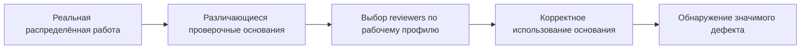

# TraceRoute: новый routing-PoM и условный переход к контролю действий

Статус: подготовка нового development PoM; результаты ещё не получены. Этот документ фиксирует решение оператора до новых review outcomes. Исполняемая preregistration с точными хешами входов, источников, prompt, моделей и бюджетов должна быть сохранена до модельного запуска. Исторические SCI/DNA runs, ответы, ошибки и frozen sources не исправляются задним числом.

## Исследовательский вопрос

Может ли организация cross-review лучше находить и использовать основания, уже возникшие в распределённой работе? Проверяем цепочку:

Основной контраст: `RandomHistory` против `WorkProfileOverlapRouted`. Последнее название соответствует существующему `RoutedHistory` в коде и артефактах. `Fresh` — диагностика. Это не новый swarm-vs-solver benchmark, не проверка необходимости сохранять знание у его первоначального владельца и не подтверждающее исследование на невиденных задачах.

## Два независимых запуска

1. **Scientific judge для уже сохранённых SCI submissions.** Подключить `openai-codex/gpt-6-astra` через существующую подписку; solver не перезапускать. Сохранить исходные rubric, prompt, изображения, forced FAILs и aggregation. Указать замену upstream judge-модели на Astra. Проверить реальные multimodal inputs и бюджеты; нельзя подменять изображения текстовым описанием. Новые оценки хранить отдельно от `runs/sci-agent-exam-executable/report.json`.
2. **Новый routing-PoM.** Новый рабочий пул и новые reviews; результаты scientific judge не являются оценками routing и не служат критерием отбора эпизодов.

`ANTHROPIC_API_KEY` не является обязательной зависимостью проекта. Это имя переменной одного upstream transport; там допускается прокси и имеется OpenAI-compatible adapter. Предыдущая научная rubric осталась unmeasured потому, что judge не был подключён к доступному backend, а не потому, что оператор обязан предоставить новый ключ.

## 1. Evidence transport до новых review outcomes

- Полные canonical evidence IDs и provenance остаются host-owned.
- Модель получает короткие локальные ссылки на разрешённые evidence objects; host разрешает ссылки в immutable source records.
- Зафиксировать источник, фактически наблюдённый фрагмент, версию/хеш и область доступа. Одинаковый текст из разных источников не превращает их в один объект.
- Автор, validator и reviewer не должны переписывать 64-символьные хеши вручную.
- Неизвестная, повреждённая или недоступная ссылка — технический отказ, а не научное отсутствие дефекта.
- Наличие корректной ссылки не доказывает семантической поддержки. Это отдельная оценка.
- Политика одинаковая для всех условий. Alias ordering не использует hidden defect labels или informed flags.
- Старые malformed outputs сохраняются без ремонта и переоценки как будто они были корректными.

До запуска нужны реальные smoke scenarios для разрешённой ссылки, неизвестной ссылки, ссылки вне доступного контекста и двух источников с одинаковым текстом. Новые permanent tests должны проверять эти границы, а не копию структуры prompt.

## 2. Evaluator calibration до новых review outcomes

Primary evaluator — GPT-6 Astra; дополнительная cross-model проверка — GPT-6.1 Sol. Validation карточек — отдельные fresh Astra contexts. Рабочие агенты, author и reviewers используют одну модель GPT-6.1 Terra, без model advantage у routed arm.

До экспериментальных reviews замораживается отдельный calibration set: содержательное возражение с достаточным основанием, корректное предложение без дефекта, неподдержанное обвинение и недостаточные данные. Ожидаемые оценочные оси и правило допуска фиксируются до ответов evaluator. Используются реальные production packets и prompt, а не упрощённый тест «умеет ли модель вернуть JSON».

Калибровочный отказ блокирует новые экспериментальные reviews. Нельзя менять критерии после ответа и затем объявлять прежнюю проверку успешной. Cross-model agreement не называется human validation. Случаи uncertainty и positive claims на valid карточках проходят предусмотренную ослеплённую adjudication; первичные labels сохраняются.

## 3. Эпизоды и contamination

Фиксированный набор — все пять уже выбранных SCI задач в исходном порядке:

1. `bioinformatics-error-diagnosis-01`;
2. `chemistry-result-interpretation-02`;
3. `materials-science-literature-synthesis-02`;
4. `mathematics-code-generation-02`;
5. `physics-simulation-tool-orchestration-01`.

Все пять уже development-consumed: просмотрены задачи, прежние рабочие истории и/или результаты проверок. Новые seed и workers не делают эти задачи независимым подтверждением. Не отбирать задачи по прежним победам Routed и не заменять неудачные эпизоды удобными новыми.

Пригодность механизма определяется до новых reviews: существует проверяемый значимый дефект, различающиеся рабочие основания и хотя бы один informed worker; доступ к основанию не одинаков у всего пула. RequiredTags формируются по valid proposal до defect injection. Router не получает hidden target evidence/defect labels; validator/evaluator не подменяются router-ом.

Не прошедшие критерии эпизоды остаются в отчёте с причинами. Нельзя исключить их из denominator и представить улучшившуюся условную метрику общей успешностью.

## 4. Однократная работа и общий замороженный пул

На задачу назначаются восемь реальных рабочих ветвей. Каждая выполняется один раз. Фиксируются tools, наблюдения, evidence, рабочее состояние, результат и профиль фактически выполненной работы. Profile — не persona label.

До первого экспериментального review замораживаются пулы, valid/def карточки и назначения panels для всех пяти задач. Один и тот же фактический пул используется обоими history-условиями; рабочие ветви не запускаются заново под выбранный routing.

Для каждого эпизода: две variants × три conditions × два repeats × два reviewers. Полный план — 60 panels, 120 review slots. Missing workers/cards/reviews не заменяются новыми samples. Transport ambiguity останавливает работу; definitive contract failure сохраняется как missingness. Resume не означает новый model dispatch для уже выполненного запроса.

Модель, review prompt, число reviewers, output/input caps, доступ к tools и критерии завершения совпадают между условиями. Фактическая длина рабочих историй может различаться; нельзя скрыть это словом «равный бюджет». Публикуются actual input/output tokens, calls, tool usage и время, отдельно от верхних лимитов. Workers и author имеют явный input cap 262144 canonical UTF-8 bytes; остальные точные лимиты фиксируются launch manifest, без усечения контекста.

Первичные reviews независимы: чужой verdict не передаётся до фиксации собственного.

## 5. Измерение механизма

Раздельно публикуются:

- **Наличие основания:** оно действительно получено в рабочей ветви и связано с проверяемым дефектом.
- **Coverage:** выбрал ли router reviewer, которому основание доступно; рядом — exact expected random coverage и realized random coverage.
- **Reference integrity:** разрешилась ли ссылка в доступный источник. Это техническая метрика.
- **Evidence use:** поддерживает ли приведённое основание конкретное возражение; простого упоминания источника недостаточно.
- **Detection:** корректно ли найден значимый дефект и объяснено его влияние на следующий шаг.
- **False positives:** ошибочные существенные обвинения на корректных предложениях, с adjudication спорных случаев.
- **Missingness:** все назначенные slots, ошибки по стадиям, доли завершения; без превращения технической ошибки в научный verdict.
- **Затраты:** фактическое потребление и время по стадиям/условиям, включая общую стоимость создания рабочего пула.

Единица интерпретации и paired comparison — задача/эпизод. 120 reviews не являются 120 независимыми исследовательскими репликациями. Успешный импорт и self-reported completion не являются detection или решением научной задачи.

Для этого нового development run заранее устанавливается консервативный переходный gate: не менее 4/5 задач с routed coverage строго выше expected random coverage; средний paired detection gain по всем пяти задачам не менее 0.25; routed false-positive rate не более 0.10 и не выше random; полное измерение, приемлемая калибровка и реально дифференцированные основания. Неизмеренный компонент не считается прошедшим. Это внутренний go/no-go ориентир, не significance test и не подтверждение универсальной эффективности routing. Условия не ослабляются после результатов.

## 6. Development-интервенция evidence

До результатов выбирается детерминированное правило: первый пригодный defect episode в фиксированном порядке и reviewer с релевантным основанием, выбранный независимо от detection outcomes. Затем отдельные независимые reviews:

- полный доступ к основанию;
- релевантное основание удалено;
- контроль удаления/замены сопоставимого нерелевантного материала, если такой контроль доступен.

Нужно проверить, не сохранено ли то же основание в других сообщениях, производных выводах, карточке или публичной задаче. Если чистое вмешательство невозможно, результат маркируется `unidentifiable`, а не выдаётся за причинную проверку. Интервенция не заменяет основной routing sample и не требует утверждения об уникальности первоначального владельца знания. Изменение citation без изменения обоснованного решения не считается положительной причинной демонстрацией.

## 7. Интерпретация отрицательных и смешанных результатов

- Нет coverage gain: проблема выбора reviewers, представления профиля или отсутствия полезной дифференциации.
- Coverage улучшилось, evidence use — нет: reviewer не смог применить доступное основание либо measurement недостаточно чувствителен.
- Evidence use улучшилось, detection — нет: проверить релевантность основания, силу дефекта и evaluator.
- Detection вырос вместе с false positives: нельзя объявлять проверку лучше по одной чувствительности.
- Fresh тоже всё обнаруживает: мало headroom для проверки routing на этих эпизодах.
- Технические отказы/неполные labels: недостаточная измеримость, а не доказанное отсутствие механизма.

Эти исходы не сворачиваются в бинарное «рой справился».

## 8. После положительного PoM: исполняемый action gate

Только после прохождения gate следующий эксперимент добавляет реальный исполняемый шаг. Reviewer рекомендует approve/change/stop/abstain; отдельный контролируемый механизм разрешает, задерживает или отклоняет конкретное действие над конкретной версией артефакта. Approval привязан к artifact hash и аргументам действия; смена артефакта не наследует старое разрешение.

Обязательные endpoints:

- ошибочные действия, которые действительно произошли;
- ошибочные действия, которые действительно предотвращены;
- корректные действия, ошибочно заблокированные;
- полезно завершённые задачи и затраты.

Текст «следует исправить» не равен предотвращённому действию. Запрет всех действий не является полезным безопасным решением. При отрицательном/неизмеримом PoM публикуются причины и downstream stage не выдаётся за обоснованный переход.

## Литературные основания и предел переноса

Greenblatt (*AI Control*) мотивирует проверять фактическое предотвращение и цену ограничения полезности, не доверять убедительным оправданиям производителя. Foerster (*CaMeLs*) отделяет структурные гарантии от правильности данных и модельных verifier verdicts. Rose (*Multi-Agent Interpretability*) подчёркивает разницу между операциональной ассоциацией и причинным механизмом, а также чувствительность к evaluator. Zhang (*Failure Attribution*) показывает ограничения разметки виновного агента/шага без intervention rerun. Riedl (*Emergent Coordination*) не позволяет подменять успех persona diversity или измерением синергии. Motwani, Mediated MARL и Stackelberg Attacks полезны для будущих threat models, но не обосновывают усложнение первого cooperative routing-PoM.

Ни одна из этих работ напрямую не устанавливает преимущество нашего `WorkProfileOverlapRouted`; оно остаётся проверяемой гипотезой.

## Формат итогового research report

Основной текст — 4–8 страниц, строго не более 8; references и appendices не входят в лимит. Финальный PDF должен быть собран и проверен по фактическому числу страниц, не по приблизительному числу слов. Основные разделы:

1. **Introduction:** вопрос и его значимость.
2. **Related Work:** связь с изученной литературой, без объявления её результатов доказательством routing.
3. **Methodology:** модели, prompts, sampling, бюджеты и metrics, достаточные для репликации. Полные prompts и freeze manifests — в приложениях.
4. **Results:** количественные данные, baselines и вариативность по задачам/повторениям; явные missingness и неизмеренные endpoints. Scientific grading сохранённых submissions отделяется от routing-PoM.
5. **Discussion:** интерпретация, ограничения и дальнейшая работа, включая условный, а не автоматически успешный переход к контролю действий.
6. **Limitations and Dual-Use / Ethical Considerations** — обязательный отдельный раздел. Указать, что результаты устанавливают и чего не устанавливают; contamination, малая выборка, зависимость от evaluator и возможные коррелированные ошибки. Описать, как распределение знаний и routing могут облегчать координацию вредоносных операций или выбор сговорившихся reviewers, создавать ложное ощущение независимости и делать вредные действия менее заметными. Не считать provenance защитой от истинных, но совместно манипулируемых сообщений.
7. **References.** Полные библиографические ссылки на фактически использованные версии.

Не публиковать секреты, OAuth tokens или credential-bearing transport logs. Репликационные приложения должны содержать научные входы и audit identifiers, а не доступ к аккаунтам. Не подменять отсутствующие outcomes прогнозами или placeholder-таблицами.
