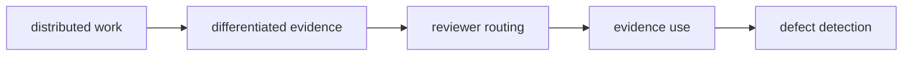

# TraceRoute Research — MINIMAL PROOF-OF-MECHANISM PROTOCOL v0.3
## Work-profile-overlap routing рецензентов в однородном рое LLM-агентов

**Статус:** внутренний proof-of-mechanism / go-no-go эксперимент  
**Назначение:** получить компактное и интерпретируемое свидетельство существования механизма до реализации полного L1–L10 harness  
**Основная модель роя:** GPT-6 Luna  
**Внешний стандартизованный evaluator:** GPT-6.1 Terra  
**Основной объект:** одинаковые экземпляры одной модели с различными реально сформированными рабочими состояниями  
**Тестируемый routing-механизм:** `work-profile-overlap routing`  
**Основной контраст:** `RandomHistory` vs `WorkProfileOverlapRouted` (в текущем harness и frozen artifacts — `RoutedHistory`); `Fresh` — диагностический baseline  
**Размер:** 6 задач, 8 рабочих ветвей на задачу, 72 review-panel runs, 144 review outputs  
**Главные результаты:** exploitability, evidence coverage, evidence use, defect detection и false positives  

**Актуальный operational plan:** [новый development routing-PoM и условный action gate](../docs/traceroute_routing_pom.md). Для нового запуска он явно фиксирует пять development-consumed SCI эпизодов, Terra workers/reviewers, Astra primary evaluator, host-owned evidence references и предварительную калибровку. Приведённые ниже параметры шестизадачного базового дизайна и human calibration не являются описанием уже выполненного или нового пятизадачного запуска. Конкретный launch manifest должен фиксировать отклонения до новых outcomes; старые freezes не меняются.

**Завершённый development run и отчёт:** [PDF — 6 страниц основного текста](../docs/traceroute_report.pdf), [журнал результатов](../docs/sequential_pilot_launch.md#завершённый-routing-pom-положительный-результат-не-получен). Получены 120/120 reviews; положительного PoM нет: target grounds оказались публичными во всех пяти эпизодах, часть adjudications осталась uncertain. Evidence intervention неприменима; условие перехода к action gate не выполнено. References и два приложения вынесены за основной текст. LaTeX-исходник сохранён локально и исключён из публикации.

---

# 1. Цель эксперимента

**TraceRoute Research** исследует, может ли структура распределённой работы использоваться для более эффективной проверки решений в рое LLM-агентов.

Основная гипотеза: разные рабочие ветви накапливают разные проверочные основания — результаты, ограничения, контрпримеры и наблюдения. Если при проверке следующего шага выбирать рецензентов с учётом того, над чем они реально работали, а не случайно, релевантные основания должны чаще попадать в review и снижать вероятность пропуска значимых ошибок.

> **Может ли организация cross-review лучше находить и использовать уже возникшие в распределённой работе основания для проверки?**

Первый proof-of-mechanism сравнивает `RandomHistory` и `WorkProfileOverlapRouted` при одном и том же фактическом пуле агентов, модели и бюджете review, включая одинаковое число reviewers. `Fresh` используется только как диагностический baseline. `WorkProfileOverlapRouted` — исследовательское название уже реализованного условия `RoutedHistory`, а не новое условие и не переименование сохранённых данных.

В этом документе **не тестируется полный dependency-aware routing из master protocol**.  
`work-profile-overlap routing` — намеренно упрощённый proxy-механизм первого PoM.

Эксперимент не проверяет полный admission mechanism, long-horizon research quality или архитектурную гетерогенность.

Первый PoM проверяет только следующий механизм:



---

# 2. Границы утверждения

Все рабочие и рецензирующие агенты используют одну и ту же модель:

\[
M_1=M_2=\dots=M_8=M,
\qquad
M=\mathrm{GPT\text{-}6\ Luna}.
\]

Различия между ними создаются совокупностью:

- назначенной реальной подзадачи;
- фактически выполненной работы;
- накопленного результата;
- локально доступных свидетельств;
- положения относительно предлагаемого следующего шага.

Поэтому положительный результат **не позволяет** утверждать, что именно accumulated history сама по себе является причиной специализации.

Core PoM проверяет более узкое утверждение:

> при одном и том же пуле реально сформированных рабочих состояний, модели и бюджете review work-profile-overlap routing способен лучше случайного назначения находить и использовать уже возникшие проверочные основания и повышать обнаружение значимых дефектов.

Это **не эквивалентно** утверждению об эффективности полного dependency-aware routing из master protocol.

Первый PoM **не пытается доказать**, что swarm лучше прямого solver-а, что распределённая работа эффективнее одиночной при равных полных затратах или что знание обязательно должно оставаться у агента, который его получил. Сравнение swarm/direct solver и сравнение рабочего владельца с новым reviewer, получившим то же evidence, — отдельные вопросы, не дополнительные требования к основному claim первого PoM.

При положительном результате следующий шаг — проверить, приводит ли такая проверка не только к обнаружению дефекта, но и к **предотвращению ошибочного последующего действия**. Этот downstream endpoint не подменяется detection и не считается измеренным текущим PoM.

Отдельное разделение влияния role prompt, history и graph position оставляется будущим `role-only` и `history-shuffle` экспериментам.

---

# 3. Проверяемые утверждения

## 3.1. Основная routing hypothesis

Пусть \(D=1\) означает корректное обнаружение целевого значимого дефекта.

Основная гипотеза:

\[
P(D=1\mid \mathrm{RoutedHistory})
>
P(D=1\mid \mathrm{RandomHistory}).
\]

Здесь `RoutedHistory` означает именно **work-profile-overlap routing**.

## 3.2. Work-state diagnostic

Дополнительный диагностический контраст:

\[
P(D=1\mid \mathrm{RandomHistory})
>
P(D=1\mid \mathrm{Fresh}).
\]

Он показывает, даёт ли наличие реального рабочего состояния полезный сигнал относительно свежего экземпляра модели без такой истории.

Этот контраст:

- **не является go/no-go критерием**;
- не используется для основного claim;
- интерпретируется только описательно.

## 3.3. Mechanism hypothesis

Маршрутизация должна влиять на detection через доступность и использование релевантного evidence:

\[
Routing
\rightarrow
EvidenceCoverage
\rightarrow
EvidenceUse
\rightarrow
DefectDetection.
\]

Но до проверки этой цепочки необходимо убедиться, что используемый overlap-router вообще способен адресовать informed workers. Это формализуется exploitability prerequisite в §10.

---

# 4. Что считается достаточной «маленькой победой»

Эксперимент рассматривается как достаточное основание для продолжения полной программы, если одновременно выполняются следующие условия.

## 4.1. Жизнеспособность пула

Не менее:

\[
5/6
\]

задач дают пригодный reviewer pool после выполнения рабочих подзадач.

Для задачи \(i\):

\[
R_i=
\{j:\text{worker }j\text{ завершил содержательную работу}\},
\]

\[
m_i=|R_i|.
\]

Минимальное требование:

\[
m_i\ge6.
\]

## 4.2. Private-evidence mechanism

Не менее чем в:

\[
4/6
\]

эпизодах должен существовать достаточный фрагмент evidence, который:

1. доступен хотя бы одному worker;
2. релевантен target defect;
3. отсутствует у `Fresh` reviewer в исходной задаче, общем досье и карточке.

## 4.3. Exploitability prerequisite

Private evidence должно быть не просто распределено по worker pool, а находиться хотя бы у одного worker, которого используемый work-profile-overlap router **может адресовать по своему собственному признаковому пространству**.

Для механистически пригодного эпизода требуется:

\[
|I_i^{exploit}|\ge1,
\]

где \(I_i^{exploit}\) определяется в §10.

Дополнительно публикуется доля informed workers с высоким tag-overlap:

\[
\rho_i^{high}
=
\frac{
|\{j\in I_i:s_{ij}\ge\tau_{tag}\}|
}{
|I_i|
},
\]

где \(s_{ij}\) — normalized tag-overlap, а \(\tau_{tag}\) замораживается до полного PoM без просмотра detection outcomes.

## 4.4. Routing coverage

Для не менее чем:

\[
4/6
\]

эпизодов должно выполняться:

\[
C_i^R > q_i^U,
\]

где \(C_i^R\) — routed coverage, а \(q_i^U\) — ожидаемое random coverage из §20.

Realized random coverage публикуется отдельно и не заменяет этот критерий.

## 4.5. Detection

Внутренний ориентир:

\[
Detection_{\mathrm{Routed}}
-
Detection_{\mathrm{Random}}
\ge0.25.
\]

Это go/no-go ориентир, а не подтверждающая статистическая граница.

## 4.6. False positives

На `valid` карточках:

\[
FP_{\mathrm{Routed}}\le0.25,
\]

и

\[
FP_{\mathrm{Routed}}
-
FP_{\mathrm{Random}}
\le0.10.
\]

## 4.7. Terra stability

Для defect-claim label требуется Terra test–retest agreement:

\[
Agreement_T^{claim}\ge0.70.
\]

Если этот порог не выполнен, результат считается **measurement-inconclusive** и не используется как отрицательное свидетельство против routing-механизма.

## 4.8. Механистически читаемые эпизоды

Не менее чем для:

\[
4/6
\]

задач должна быть воспроизводима последовательность:

\[
WorkerTask
\rightarrow
PrivateEvidence
\rightarrow
TagOverlap
\rightarrow
RouterSelection
\rightarrow
ReviewerCitation
\rightarrow
ValidatedDetection.
\]

---

# 5. Источник и фиксация задач

По решению владельца проекта PoM проводится на **публичном корпусе Terminal-Bench-Science**, зафиксированном локальным commit и SHA-256 manifest в `data/terminal-bench-science/`.

Это наш development corpus, а не утверждение о наличии официального development split. SCI-AGENT-EXAM сохранён отдельно только как справочная публичная выборка; корпуса не смешиваются. Из eligible задач Terminal-Bench-Science выбираются отдельная D0 и шесть основных задач по описанным ниже правилам. Смена источника зафиксирована до model calls и выбора основных IDs.

## 5.1. Критерии включения

Задача eligible, если:

1. допускает несколько содержательно разумных исследовательских подзадач;
2. имеет достаточно материала для формирования 8 рабочих ветвей;
3. позволяет сформулировать следующий исследовательский шаг;
4. допускает создание одного значимого дефекта;
5. существует локализуемое свидетельство, способное поддержать обнаружение этого дефекта;
6. задача не требует внешнего веб-доступа.

## 5.2. Seeded selection

После применения §5.1 ко всему доступному development pool:

1. формируется список eligible task IDs;
2. список упорядочивается по заранее frozen seed;
3. первые **6 конкретных task IDs** становятся PoM corpus;
4. полный seeded order и выбранные 6 IDs freeze до первого worker call.

Выбор задач после просмотра worker/review outcomes запрещён.

## 5.3. Development-consumed

Как только по task выполнен первый model call, task считается development-consumed.

Он:

- не возвращается в candidate pool;
- не заменяется из-за неблагоприятного результата;
- не может быть выбран заново в confirmatory stage.

Если task после начала работы проваливает downstream gate, это фиксируется как failed PoM episode, а не повод пересобрать корпус.

D0 при необходимости проводится на отдельной development task, не входящей в шесть PoM task IDs.

---

# 6. Типы дефектов

Используются шесть типов — по одному на задачу:

1. несоответствие исходной цели;
2. игнорирование установленного результата;
3. принятие предположения за факт;
4. невыполненное предварительное условие;
5. отсутствие связи результата с последующим решением;
6. несоразмерный масштаб исполнения.

Типы обеспечивают разнообразие PoM и не сравниваются между собой статистически.

---

# 7. Рабочие ветви

Для каждого эпизода создаются:

\[
8
\]

workers.

Все используют одну модель и одну конфигурацию.

## 7.1. Рабочие подзадачи

| Worker | Подзадача |
|---|---|
| \(w_1\) | baseline / воспроизводимость |
| \(w_2\) | данные и provenance |
| \(w_3\) | предпосылки и необходимые условия |
| \(w_4\) | альтернативное объяснение |
| \(w_5\) | метрика / измерение |
| \(w_6\) | robustness / sensitivity |
| \(w_7\) | вычислительные и ресурсные ограничения |
| \(w_8\) | связь результата с последующим решением |

Допускается минимальная task-specific адаптация текста подзадачи, если она зафиксирована до выполнения workers и не зависит от будущего target defect.

## 7.2. Лимит работы

Стартовый лимит:

\[
T_{\max}=4
\]

модельных хода на worker.

## 7.3. Worker output

Каждая ветвь возвращает:

\[
O_{ij}
=
(
R_{ij},
E_{ij},
L_{ij}
),
\]

где:

- \(R_{ij}\) — содержательный результат;
- \(E_{ij}\) — использованные evidence fragments;
- \(L_{ij}\) — ограничения и неопределённости.

Ветвь без содержательного результата или проверяемого ограничения не входит в reviewer pool.

---

# 8. Work profiles

Чтобы `RoutedHistory` действительно использовал результаты работы, а не только заранее назначенную роль, после завершения worker stage для каждой ветви строится frozen work profile:

\[
WProfile_{ij}
=
Tags(O_{ij}).
\]

Примеры тегов:

- `precondition:data_quality`;
- `constraint:compute_budget`;
- `artifact:baseline_02`;
- `metric:rare_failure_rate`;
- `decision:continue_if_significant`.

Теги выводятся из фактического worker output и не используют:

- target defect;
- human evidence labels;
- список informed workers.

Это обеспечивает различие между:

> «worker был назначен критиком предпосылок»

и

> «worker реально обнаружил/исследовал конкретную предпосылку».

---

# 9. Evidence provenance

Для каждого содержательного evidence fragment фиксируются:

- стабильный `evidence_id`;
- исходный источник;
- сам фрагмент;
- workers, которые его получили или использовали.

Identity evidence не зависит от worker identity: два workers, нашедшие один и тот же fragment, ссылаются на один evidence object, но имеют разный provenance.

Для target defect заранее фиксируется:

\[
E_i^{target}
\]

— набор достаточных supporting evidence fragments.

---

# 10. Private-evidence gate и exploitability prerequisite

## 10.1. Private evidence относительно Fresh

Для `Fresh` определяется его информационная область:

\[
V_i^{Fresh}
=
Task_i
\cup
CommonDossier_i
\cup
Card_i.
\]

Private target evidence:

\[
E_i^{private}
=
E_i^{target}
\setminus
V_i^{Fresh}.
\]

Для механистического анализа требуется:

\[
|E_i^{private}|\ge1.
\]

## 10.2. Informed workers

Пусть:

\[
I_i
=
\{
j\in R_i:
Evidence(w_{ij})
\cap
E_i^{target}
\neq\varnothing
\}.
\]

Private-informed workers:

\[
I_i^{private}
=
\{
j\in I_i:
Evidence(w_{ij})
\cap
E_i^{private}
\neq\varnothing
\}.
\]

## 10.3. Tag overlap

Для worker \(j\):

\[
s_{ij}
=
\frac{
|WProfile_{ij}\cap Req_i|
}{
|Req_i|
},
\]

если \(|Req_i|>0\).

Exploitability set:

\[
I_i^{exploit}
=
\{
j\in I_i^{private}:
s_{ij}>0
\}.
\]

Необходимое предусловие механистического PoM:

\[
|I_i^{exploit}|\ge1.
\]

То есть private evidence должно находиться хотя бы у одного worker, чьи work-tags пересекаются с \(Req_i\).

Без этого отрицательный результат нельзя отличить от ситуации:

> relevant evidence существует, но выбранные теги являются плохим proxy и router принципиально не может его адресовать.

## 10.4. High-overlap diagnostic

Дополнительно публикуется:

\[
\rho_i^{high}
=
\frac{
|\{j\in I_i:s_{ij}\ge\tau_{tag}\}|
}{
|I_i|
}.
\]

\(\tau_{tag}\) замораживается до полного PoM без просмотра detection outcomes.

Также публикуется полный набор \(s_{ij}\) для informed workers, чтобы вывод не зависел только от одного порога.

Если exploitability prerequisite не выполнен, эпизод можно сохранить как общую detection-диагностику, но он не используется как отрицательное свидетельство против routing-механизма.

---

# 11. Авторская карточка

После worker stage отдельный экземпляр Luna выступает author.

Он получает компактные handoffs:

\[
h_{ij}
=
(
result,
evidence\ ids,
limitations
).
\]

Author формирует исходный proposal:

\[
q_i^0.
\]

Он содержит:

1. proposed action;
2. uncertainty;
3. grounds;
4. expected decision impact;
5. scale/budget;
6. preconditions.

\(q_i^0\) является **ProposalCard** и ещё не является `valid` или `def`.

---

# 12. Пара `valid/def`

Человеческий validator создаёт:

\[
q_i^{valid}
\]

как минимально исправленную или подтверждённую версию \(q_i^0\).

Затем:

\[
q_i^{def}
\]

получается внесением ровно одного target defect.

Обе версии являются **ExperimentalCard** и сохраняют ссылку на исходный ProposalCard.

Validator подтверждает:

1. target defect присутствует;
2. второго значимого дефекта нет;
3. target evidence существует;
4. informed workers существуют;
5. private-evidence gate проверен.

---

# 13. Representation следующего шага для router

До defect injection из \(q_i^{valid}\) формируется frozen representation:

\[
Req_i.
\]

Она описывает, какие типы evidence/constraints/artifacts релевантны предложенному шагу.

Примеры:

- `precondition:data_quality`;
- `metric:rare_failure_rate`;
- `constraint:compute_budget`.

Эта representation не использует target defect.

Одна и та же routed panel применяется к `valid` и `def`:

\[
D_i^{valid}=D_i^{def}.
\]

---

# 14. Экспериментальные условия

Используются:

\[
c\in
\{
Fresh,
RandomHistory,
RoutedHistory
\}.
\]

Размер panel:

\[
k=2.
\]

`RoutedHistory` в этом PoM означает **work-profile-overlap routing**, а не полный dependency-aware routing master protocol.

---

# 15. Fresh

Два свежих экземпляра Luna.

Они:

- не выполняли worker tasks;
- не получают worker output/history;
- получают только task, common dossier и card.

Это baseline без accumulated worker state.

---

# 16. RandomHistory

Два reviewers равномерно выбираются без возвращения из фактического complete pool:

\[
U_{ir}
\sim
Uniform
\left\{
S\subseteq R_i:|S|=2
\right\}.
\]

Для двух repeats используются **две независимо выбранные random panels**:

\[
U_{i1}\neq U_{i2}
\]

не требуется буквально, но sampling выполняется независимо.

Таким образом variability `RandomHistory` включает:

1. stochasticity модельных review calls;
2. вариативность состава panel.

---

# 17. RoutedHistory

Router использует work profiles и representation следующего шага.

Для worker \(j\):

\[
score_{ij}
=
|
WProfile_{ij}
\cap
Req_i
|.
\]

Первый reviewer:

\[
j_1
=
\arg\max_{j\in R_i}
score_{ij}.
\]

Второй reviewer выбирается для complementary coverage:

\[
j_2
=
\arg\max_{j\neq j_1}
|
WProfile_{ij}
\cap
(Req_i\setminus WProfile_{ij_1})
|.
\]

При равенстве используется deterministic tie-break.

## 17.1. Fallback при пустом complementary set

Если:

\[
Req_i\setminus WProfile_{ij_1}=\varnothing
\]

или все оставшиеся workers имеют нулевой complementary score, второй reviewer выбирается среди оставшихся workers по максимальному **общему** overlap:

\[
\arg\max_{j\neq j_1}
|
WProfile_{ij}\cap Req_i
|.
\]

Если и он равен нулю для всех кандидатов, используется deterministic frozen tie-break и событие помечается как `router_fallback`.

Доля fallback публикуется отдельно.

## 17.2. Что router не видит

Router не получает:

- target defect;
- target evidence;
- informed-worker labels.

## 17.3. Одна routed panel для valid/def

Routed panel определяется по pre-defect representation и поэтому одинакова для:

\[
q_i^{valid},
\qquad
q_i^{def}.
\]

## 17.4. Асимметрия repeats

В `RoutedHistory` используется **одна и та же routed panel в обоих repeats**.

Поэтому variability Routed включает в основном:

- stochasticity независимых review calls одной и той же пары workers.

В `RandomHistory` состав panel пересэмплируется между repeats.

Следовательно:

\[
Var(RandomHistory)
\]

содержит дополнительную panel-composition variance, которой нет в Routed.

При \(n=6\) нельзя интерпретировать различия variance между условиями как самостоятельный эффект routing. Основной контраст остаётся различием средних detection/coverage, а не стабильности condition.

---

# 18. Review protocol

Каждый reviewer независимо получает:

- card;
- common dossier;
- своё worker state для Random/Routed;
- никакое worker state для Fresh.

Reviewer не видит:

- condition;
- другого reviewer-а;
- target defect;
- informed labels;
- routing score.

Reviewer пишет **свободное содержательное описание дефекта**, а не обязан выбрать один из шести экспериментальных defect types.

Формат:

```text
Status:
- defect_found
- no_significant_defect
- insufficient_context

Claimed defect:
...

Evidence:
[evidence_id, ...]

Why it changes the next step:
...
```

Нормализация свободного текста к defect type выполняется позже Terra (§23–24).

---

# 19. Повторения и объём

Для:

- 6 задач;
- 2 variants;
- 3 conditions;
- 2 repeats;

получается:

\[
6\times2\times3\times2
=
72
\]

panel runs.

При двух reviewers:

\[
72\times2
=
144
\]

review outputs.

Worker budget:

\[
6\times8\times4
=
192
\]

максимальных worker turns.

### Ограничение интерпретации repeats

Два repeats не являются полноценной оценкой variance condition.

Они используются для:

- уменьшения зависимости detection от единичного model sample;
- получения двух realized random panels;
- проверки воспроизводимости эффекта на минимальном объёме.

Episode остаётся основной единицей интерпретации.

---

# 20. Evidence coverage и exploitability

## 20.1. Expected random coverage

Пусть:

\[
a_i=|I_i|.
\]

Для random panel expected coverage:

\[
q_i^U
=
1-
\frac{
\binom{m_i-a_i}{2}
}{
\binom{m_i}{2}
}.
\]

## 20.2. Realized coverage

\[
C_i(S)
=
\mathbf1
\{
S\cap I_i\neq\varnothing
\}.
\]

Для Routed:

\[
C_i^R=C_i(D_i).
\]

Для Random:

\[
\bar C_i^U
=
\frac12
\sum_{r=1}^{2}
C_i(U_{ir}).
\]

Публикуются:

\[
C_i^R-q_i^U
\]

и:

\[
C_i^R-\bar C_i^U.
\]

Из-за асимметрии repeats **expected random coverage \(q_i^U\)** является основным benchmark для mechanistic coverage claim; realized coverage используется как дополнительное наблюдение.

## 20.3. Exploitability metrics

Для каждого эпизода публикуются:

\[
|I_i|,
\quad
|I_i^{private}|,
\quad
|I_i^{exploit}|,
\]

и:

\[
\rho_i^{high}.
\]

Также публикуется доля informed workers с любым ненулевым overlap:

\[
\rho_i^{>0}
=
\frac{
|\{j\in I_i:s_{ij}>0\}|
}{
|I_i|
}.
\]

Это позволяет отличить:

1. routing failure при доступном signal;
2. плохой tag proxy, при котором informed workers не адресуются через \(Req_i\).

Для `Fresh` accumulated-worker coverage по определению равно 0, но отдельно фиксируется наличие target evidence в его общем контексте через private-evidence gate.

---

# 21. Evidence use

Для reviewer:

\[
Use_{ij}
=
\mathbf1
\{
reviewer
\text{ сослался на target evidence}
\}.
\]

Это позволяет различить:

\[
\text{evidence доступно}
\]

и:

\[
\text{evidence использовано}.
\]

---

# 22. Почему Terra используется как основной evaluator

Human expert judgement содержит значимую межэкспертную вариативность.

Для небольшого PoM желательно иметь один стандартизованный измерительный инструмент для всех 144 review outputs.

Поэтому:

\[
M_E
=
\mathrm{GPT\text{-}6.1\ Terra}
\]

используется как primary blind evaluator.

Terra не является ground truth и не входит в исследуемый swarm.

Люди используются для:

1. calibration Terra;
2. adjudication Terra uncertainty;
3. проверки всех Terra-positive на `valid`;
4. разрешения human-human disagreement.

Таким образом Terra используется как стандартизованный measurement instrument, а human raters служат якорем против возможной систематической ошибки evaluator-а.

---

# 23. Terra evaluation

## 23.1. Единица

Terra оценивает каждый из:

\[
144
\]

review outputs отдельно.

## 23.2. Blindness

Terra получает:

- task;
- card;
- свободный текст review claim;
- evidence, процитированное reviewer-ом;
- reviewer explanation.

Terra не получает:

- `Fresh/Random/Routed`;
- reviewer identity;
- panel composition;
- routing rule;
- target defect label;
- `valid/def` label;
- informed workers;
- target evidence list.

## 23.3. Нормализация defect type

Reviewer **не выбирает экспериментальный defect type**.

Terra нормализует свободный текст reviewer-а в:

\[
\{
goal\_mismatch,
ignored\_result,
assumption\_as\_fact,
unmet\_precondition,
no\_link\_to\_decision,
disproportionate\_scale,
other,
none
\}.
\]

## 23.4. Выход

Terra возвращает:

- есть ли содержательное утверждение о significant defect;
- normalized defect type;
- поддерживается ли claim процитированным evidence;
- действительно ли claim должен менять следующий шаг;
- uncertainty flag.

---

# 24. Defect detection

Terra не получает target defect.

После freeze Terra labels обычный код сравнивает **Terra-normalized defect type**, а не свободный текст reviewer-а, с hidden target defect.

## 24.1. Frozen equivalence mapping

До первого Terra evaluation замораживается допустимое equivalence mapping:

\[
Eq(d_i^{target})
\]

для заранее определённых близких формулировок/пограничных категорий.

Detection допускает:

\[
TerraType_{ij}
\in
Eq(d_i^{target}).
\]

Mapping нельзя изменять после просмотра Terra outcomes.

## 24.2. Reviewer-level detection

Для reviewer:

\[
D_{ij}=1
\]

если одновременно:

1. Terra-normalized defect type входит в \(Eq(d_i^{target})\);
2. Terra подтверждает поддержку claim процитированным evidence;
3. Terra подтверждает, что claim действительно меняет следующий шаг.

Panel outcome:

\[
D_{icr}^{panel}
=
\max_{j\in panel}
D_{ij}.
\]

## 24.3. Строгость критерия

Этот критерий намеренно **консервативен**.

Даже после frozen equivalence mapping он требует не просто замечания reviewer-а, а полного сочетания:

\[
correct\ defect\ family
+
supported\ evidence
+
decision\ relevance.
\]

Поэтому абсолютный detection rate может быть низким.

PoM интерпретирует прежде всего **разницу между условиями**, а не высокий абсолютный уровень \(D\).

---

# 25. False positives

На `valid` карточке Terra-positive claim **не считается автоматически false positive**.

Каждый случай:

\[
Valid
\land
TerraPositive
\]

обязательно передаётся human adjudicator.

После adjudication:

\[
FP^{panel}_{icr}=1
\]

только если panel действительно сделал ложное утверждение о значимом дефекте.

Это защищает от ситуации, когда первоначальная human validation `valid` карточки сама пропустила дефект.

---

# 26. Human calibration

До просмотра Terra labels выбираются:

\[
n_{cal}=36
\]

review outputs.

Приоритетная стратификация:

- 12 Fresh;
- 12 RandomHistory;
- 12 RoutedHistory;

внутри condition — по возможности баланс `valid/def`.

Каждый output независимо оценивают два человека.

Human raters не видят:

- Terra label;
- condition;
- reviewer identity;
- routing metadata.

При disagreement используется adjudicator.

---

# 27. Terra–human agreement и предел измерения

На calibration subset публикуются:

- raw agreement;
- balanced accuracy;
- confusion matrix;
- agreement по defect type;
- agreement по evidence support;
- agreement по decision relevance.

При:

\[
n_{cal}=36
\]

эти показатели являются диагностическими и имеют широкую неопределённость.

Поэтому отрицательный routing result нельзя автоматически интерпретировать как отсутствие механизма, если calibration показывает, что Terra плохо распознаёт те же классы корректных human-validated reviews.

В частности, при малом calibration sample невозможно надёжно отделить:

\[
\text{routing не создаёт эффекта}
\]

от:

\[
\text{эффект существует, но evaluator его не видит}.
\]

Если measurement quality явно недостаточна, итоговый статус должен быть:

> **MEASUREMENT INCONCLUSIVE**

а не `NO-GO` по routing-механизму.

---

# 28. Mandatory adjudication

Человеку автоматически передаются:

1. все:
   \[
   Terra.uncertain=True;
   \]

2. все:
   \[
   valid\land TerraPositive;
   \]

3. все human-human disagreements calibration subset.

---

# 29. Terra test–retest

Случайные:

\[
20\%
\]

review outputs проходят повторную blind evaluation Terra.

При полном наборе:

\[
n_{retest}\approx29.
\]

Повтор не используется для majority vote.

Измеряется стабильность:

\[
Agreement_T
=
P(
Label^{(1)}=Label^{(2)}
).
\]

Отдельно по:

- defect claim;
- normalized defect type;
- evidence support;
- decision relevance.

Основной stability gate:

\[
Agreement_T^{claim}\ge0.70.
\]

Остальные agreement metrics публикуются как diagnostics.

---

# 30. Основные метрики

## 30.1. Detection

\[
Detection_c
=
P(
D^{panel}=1
\mid
def,c
).
\]

## 30.2. False positives

\[
FP_c
=
P(
FP^{panel}=1
\mid
valid,c
).
\]

## 30.3. Coverage

\[
Coverage_c.
\]

## 30.4. Evidence use

\[
EvidenceUse_c.
\]

## 30.5. Conditional detection — diagnostic

\[
Detection_c
\mid
Coverage=1.
\]

Из-за малого числа эпизодов эта метрика является **diagnostic only** и не используется как отдельный go/no-go критерий.

## 30.6. Exploitability

Публикуются:

\[
|I_i^{exploit}|,
\qquad
\rho_i^{>0},
\qquad
\rho_i^{high}.
\]

---

# 31. Основная таблица результата

| Condition | Evidence coverage | Evidence use | Defect detection | False positive |
|---|---:|---:|---:|---:|
| Fresh | — | — |  |  |
| RandomHistory |  |  |  |  |
| RoutedHistory |  |  |  |  |

---

# 32. Механистическая таблица

Для каждого эпизода публикуется:

| Episode | Defect type | Private evidence | Informed workers | Exploitable informed | \(\rho_i^{high}\) | \(q_i^U\) | Routed coverage | Detection Random | Detection Routed |
|---|---|---:|---:|---:|---:|---:|---:|---:|---:|
| 1 |  |  |  |  |  |  |  |  |  |
| ... | | | | | | | | | |

Дополнительно для каждого informed worker публикуется его normalized overlap:

\[
s_{ij}.
\]

Эта таблица должна позволять отличить:

- отсутствие differentiated evidence;
- наличие evidence, но плохой tag proxy;
- успешную exploitability, но failure reviewer-а использовать evidence;
- successful routing → evidence use → detection.

---

# 33. Анализ

Эксперимент является демонстрационным.

Используются:

- абсолютные доли;
- paired episode-level differences;
- descriptive bootstrap intervals;
- Terra–human agreement;
- Terra test–retest;
- никаких подтверждающих p-value claims.

Bootstrap intervals используются только как **описательная мера неопределённости** и **не интерпретируются как p-value, significance test или подтверждающий inferential criterion**.

Основные differences:

\[
\Delta_D^{R-U}
=
Detection_R
-
Detection_U.
\]

\[
\Delta_D^{U-F}
=
Detection_U
-
Detection_F.
\]

\(\Delta_D^{U-F}\) является diagnostic contrast и не входит в GO criterion.

\[
\Delta_{FP}^{R-U}
=
FP_R
-
FP_U.
\]

При анализе повторений episode остаётся основной единицей интерпретации; нельзя трактовать 72 panel runs как 72 независимых исследовательских единицы.

---

# 34. Go / No-Go

## 34.1. GO

Продолжать полный L1–L10 проект, если одновременно:

1. не менее 5/6 задач имеют пригодный worker pool;
2. не менее 4/6 имеют private target evidence;
3. не менее 4/6 имеют:
   \[
   |I_i^{exploit}|\ge1;
   \]
4. не менее 4/6 имеют:
   \[
   C_i^R>q_i^U;
   \]
5. \(\Delta_D^{R-U}\) порядка \(+0.25\) или более;
6. \(FP_R\) не растёт существенно по критериям §4.6;
7. не менее 4 эпизодов имеют читаемую mechanistic trace;
8. Terra defect-claim test–retest:
   \[
   Agreement_T^{claim}\ge0.70;
   \]
9. human calibration не показывает очевидной систематической неспособности Terra распознавать корректные detection cases.

Контраст:

\[
RandomHistory > Fresh
\]

не является условием GO.

## 34.2. CONDITIONAL GO — reviewer-use bottleneck

Если:

\[
C_i^R>q_i^U
\]

в большинстве mechanistically eligible episodes, но:

\[
Detection_R\approx Detection_U,
\]

и Terra measurement quality приемлема, следующий эксперимент должен исследовать способность reviewer-а использовать доступное evidence, а не расширять admission infrastructure.

## 34.3. REDESIGN — routing representation

Если private evidence и differentiated worker states существуют, но:

\[
I_i^{exploit}=\varnothing
\]

или \(\rho_i^{high}\) систематически мала, вывод:

> текущие work-tags / \(Req_i\) являются плохим proxy для нужной зависимости.

Это **не** отрицательное свидетельство против более общего routing-механизма.

## 34.4. REDESIGN — mechanism

Если exploitability присутствует, но work-profile-overlap router не повышает coverage относительно:

\[
q_i^U
\]

на достаточном числе эпизодов, перерабатывается routing rule.

## 34.5. MEASUREMENT INCONCLUSIVE

Если:

\[
Agreement_T^{claim}<0.70
\]

или human calibration указывает на существенную evaluator insensitivity/instability, эксперимент не классифицируется как отрицательный routing result.

Сначала перерабатывается measurement layer.

---

# 35. Что сознательно оставлено на потом

Не входит в PoM:

- 20 workers;
- L2;
- production research graph;
- Jaccard;
- production ACL;
- runtime grants;
- admission;
- moderation;
- revision;
- resolution;
- natural corpus;
- полный evidence-map;
- graph audit;
- production event sourcing;
- canary/drift infrastructure;
- cost normalization;
- blocked randomization;
- confirmatory power;
- ResearchClawBench;
- role-only control;
- history-shuffle control;
- heterogeneous-model swarm.

---

# 36. Следующие эксперименты при положительном PoM

Если PoM проходит go/no-go, следующие mechanistic controls должны различить источник наблюдаемого эффекта.

## 36.1. Role-only

Свежая Luna получает только описание рабочей позиции, без накопленной worker history.

## 36.2. History-shuffle

Реальные worker histories переставляются между позициями/requirements.

## 36.3. Full dependency-aware routing

Только после положительного PoM work-profile-overlap mechanism заменяется на тот dependency/provenance-aware routing, который определён в полном протоколе.

## 36.4. Architectural heterogeneity

Сравнение homogeneous и heterogeneous reviewer pools проводится только после того, как установлено, что механизм существует в однородном рое.

---

# 37. Итоговая схема

\[
\boxed{
Task_i
\rightarrow
8\times Luna\ work\ states
\rightarrow
WorkProfiles
\rightarrow
q_i^{valid}/q_i^{def}
}
\]

\[
\boxed{
Fresh
\quad vs\quad
RandomHistory
\quad vs\quad
WorkProfileOverlapRouted
}
\]

\[
\boxed{
Exploitability
\rightarrow
Coverage
\rightarrow
EvidenceUse
\rightarrow
DefectDetection
}
\]

\[
\boxed{
144\ reviews
\rightarrow
Terra
\rightarrow
HumanCalibration/Adjudication
}
\]

при контроле:

\[
FalsePositive.
\]

---

# 38. Допустимая интерпретация результата

## 38.1. Основной claim

При положительном результате допустимо утверждать:

> В данном наборе задач простой **work-profile-overlap router**, используя профили фактически выполненной работы, чаще случайного назначения выбирал reviewer states, способные предоставить релевантное private evidence для следующего шага. Повышенное evidence coverage сопровождалось более частым обнаружением целевых дефектов без сопоставимого роста ложных тревог.

Это основной claim PoM:

\[
routing\ exploit
\rightarrow
higher\ coverage/use
\rightarrow
higher\ detection.
\]

## 38.2. Необходимое условие, сделавшее claim возможным

Этот эффект возможен только потому, что в исследованных задачах действительно возникли различающиеся рабочие состояния:

- evidence было неравномерно распределено;
- часть evidence оставалась private относительно Fresh;
- хотя бы часть informed workers была адресуема через work-profile/\(Req_i\) overlap.

То есть differentiation является **необходимым условием** наблюдаемого routing effect, а не главным результатом само по себе.

## 38.3. Ограничение measurement quality

Claim допустим только при приемлемой стабильности Terra:

\[
Agreement_T^{claim}\ge0.70
\]

и отсутствии явных признаков систематической evaluator insensitivity в human calibration.

Поскольку:

\[
n_{cal}=36,
\]

human calibration остаётся малой диагностической выборкой.

Поэтому отсутствие observed routing effect при слабой Terra–human согласованности нельзя трактовать как доказательство отсутствия механизма.

В таком случае допустимый вывод:

> measurement layer недостаточно надёжен для отрицательного заключения.

## 38.4. Что PoM не доказывает

Положительный результат не позволяет утверждать:

- что accumulated history сама по себе вызвала специализацию;
- что work-profile-overlap routing эквивалентен dependency-aware routing полного протокола;
- что полный admission pipeline будет эффективен;
- что эффект переносится на длинную автономную исследовательскую траекторию;
- что архитектурная гетерогенность бесполезна;
- что используемый router оптимален.

Задача PoM — только ответить, существует ли достаточно сильный и технически exploitable механизм, чтобы оправдать следующий уровень исследования.
